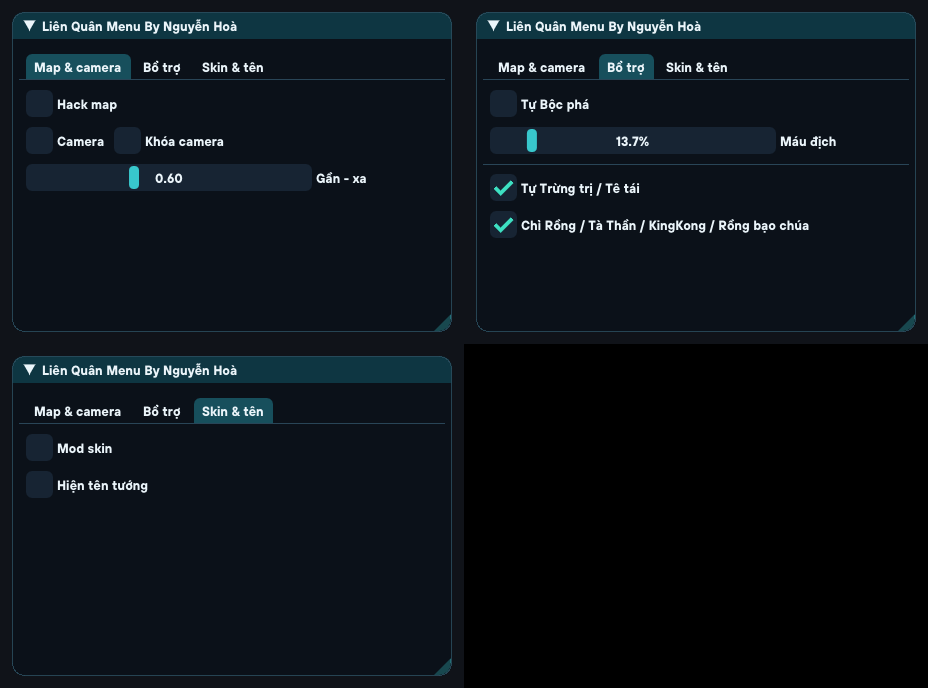

# KHTN SMLnobita — source v13

Bộ source menu và các chức năng đang dùng ở bản v13, xuất ngày 20/10/2026 để đưa lên GitHub. Đây là mã module tùy chỉnh, không phải toàn bộ mã nguồn game.



## Cấu trúc

| Đường dẫn | Nội dung |
| --- | --- |
| `project/menu` | Giao diện ImGui/Metal, tab, nút, font, theme, xử lý safe area |
| `project/src` | Runtime và bridge: map, camera, Mod skin, Bộc phá, Trừng trị, tên tướng |
| `project/build` | Script chuẩn bị module/đóng IPA, source test và renderer preview |
| `project/build-khtn.ps1` | Build module ARM64 iOS trên Windows bằng Zig |
| `anhnew` | Ba asset icon của bản v13 |
| `verification` | Báo cáo kiểm tra và đóng gói của bản v13 đã build trước đó |
| `docs` | Tài liệu kỹ thuật; có cả ghi chú lịch sử và đường dẫn trên máy gốc |

## Build module trên Windows

Cần PowerShell, Python 3 và Zig 0.13.0 cùng iPhoneOS16.5 SDK. Toolchain/SDK không nằm trong ZIP; trên máy gốc chúng vẫn ở thư mục project/build của dự án Liên Quân. Đặt chúng đúng cấu trúc này trong bản clone (các thư mục đã được gitignore):

```text
project/build/zig013/ziglang/zig.exe
project/build/zig013/ziglang/lib/
project/build/apple-sdks/iPhoneOS16.5.sdk/
```

Từ thư mục gốc repository:

```powershell
Set-Location project
.\build-khtn.ps1 -InstallName "@rpath/SMLnobita.framework/SMLnobita"
python build\prepare_module_khtn.py
```

Kết quả là `project/build/Clone6-khtn-raw` và module có chữ ký ad-hoc `project/build/Clone6-khtn`. Clone6/C6 là tên nội bộ lịch sử; install name của bản build trên là SMLnobita. Menu và runtime được build chung thành một module.

Script `build-khtn-macos.sh` và Makefile trong menu được giữ từ dự án để tham khảo. Chúng còn cấu hình Clone6 cũ, chưa được đồng bộ/xác minh cho pipeline v13 trên macOS; hướng dẫn đã kiểm tra của bộ này là PowerShell ở trên.

## Đóng IPA v13 (tùy chọn)

Build module không cần IPA. Để đóng thành IPA, tự đặt bản nền `KHTN-SMLnobita-v12.ipa` vào `project/`. Bản nền không nằm trong ZIP và bị gitignore. Script chỉ chấp nhận đúng SHA256:

```text
c58e0e3c80b0e1b962c74ae3612e484da14b80fb8981b4046af9df3715efd70f
```

Từ root repository:

```powershell
python -m pip install -r requirements.txt
Set-Location project
python build\package_menu_v13.py
```

Script dùng module vừa chuẩn bị và ba asset `anhnew`, xuất `project/KHTN-SMLnobita-v13.ipa`. Cần ký lại toàn bộ IPA/framework bằng chứng chỉ trước khi cài. ZIP không chứa game, IPA, compiler/SDK hoặc dữ liệu ký.

## Test và trạng thái kiểm tra

Source test nằm ở `project/build/test_*.c` và `test_*.cpp`. Ví dụ chạy test bố cục trên máy có C++ compiler, từ thư mục `project`:

```powershell
clang++ -std=c++11 build/test_menu_layout.cpp menu/IMGUI/imgui.cpp menu/IMGUI/imgui_draw.cpp menu/IMGUI/imgui_widgets.cpp menu/IMGUI/imgui_tables.cpp -o build/test_menu_layout.exe
.\build\test_menu_layout.exe
```

Báo cáo trong `verification` ghi lần kiểm tra bản v13 trên máy gốc: bảy test PASS, build ARM64 iOS PASS, kiểm tra chữ ký ad-hoc và IPA. Đường dẫn tuyệt đối trong báo cáo là lịch sử, không phải yêu cầu trên máy mới. Bộ export đã được đối chiếu hash source với dự án và kiểm tra CRC ZIP; chưa build lại từ ZIP trên máy sạch hay thử iPhone.

Đọc `THIRD_PARTY.md` trước khi chọn giấy phép cho repository. Để đưa lên GitHub, giải nén và dùng toàn bộ nội dung thư mục này làm root repository; nhớ bật hiển thị file ẩn để giữ `.gitignore`.

## Bổ sung ngày 23/10/2026 — trạng thái hiện hành: v16

Phần mô tả v13 phía trên được giữ làm lịch sử. Bản hiện hành là **v16**, thêm phần chặn báo cáo anti-cheat port từ AWSS3 donor `6bohuel`; menu và Trừng trị không đổi.

- `project/src/TssGuard.mm`: stub 7 lớp Tss/Ano, 23 fragment URL, 12 fragment body, 6 hook site, decoy `http://127.0.0.1:1/void`, fake HTTP 200 và ẩn `netdata.bin`.
- `project/build-khtn.ps1` đã thêm `src\TssGuard.mm` vào danh sách biên dịch.
- `project/build/package_menu_v16.py` đóng IPA v16 từ nền v15; script kiểm tra SHA256 nền và chỉ thay entry SMLnobita.
- Tài liệu chi tiết: `docs/V16-ANTIBAN.md`. Báo cáo: `verification/package-v16.json`, `verification/validation-v16.json`.
- Kết quả trên máy gốc: 7/7 test host PASS, build ARM64 iOS PASS, module ad-hoc 211 trang; IPA release SHA256 `4db6755ef8bb2e84157070605bf2aa84bf9127ba3091b634891a94824eb66c06` (220.684.990 byte). Người dùng đã ký, cài và chơi một ván; chưa test shop/nạp, chưa chạy donor A/B.
- Ảnh `preview/menu-v13.png` vẫn là preview đúng vì menu không đổi. `build-khtn-macos.sh` và `Makefile` vẫn là tài liệu lịch sử, chưa đồng bộ TssGuard; pipeline đã kiểm tra là PowerShell/Zig.

### Đóng gói v16 (tùy chọn)

Build module như mục trên, sau đó đặt bản nền `KHTN-SMLnobita-v15.ipa` vào `project/` với SHA256:

```text
fc8b9f91e25b82bbb3abd5e7ddb5d18ac49b0c2ae227586dc620ec1d55ac0a54
```

Từ root repository:

```powershell
Set-Location project
python build\package_menu_v16.py
```

Script chỉ thay entry `Payload/kgvn.app/Frameworks/SMLnobita.framework/SMLnobita`, kiểm tra CRC/entry list và xuất `project/KHTN-SMLnobita-v16.ipa`. Cần ký lại toàn bộ IPA/framework trước khi cài.

### Giới hạn xác minh

Hash/build/test host không thay thế ký chứng chỉ, kiểm thử thiết bị đầy đủ hoặc xác nhận phía server. Traffic capture chỉ một phần; việc không thấy một số domain anti-cheat không chứng minh tuyệt đối việc chặn phía server.
